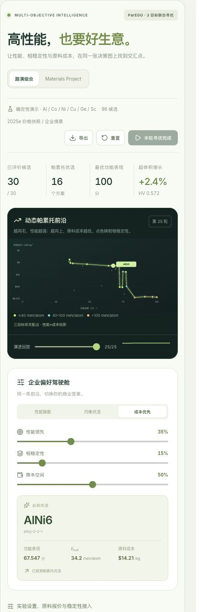

# 多目标帕累托寻优引擎

联合目标为功能表现最大化、Ehull最小化、原料采购价格最小化。原单目标主动学习保持独立；采购价格也不复用旧 `Material.cost` 的评价代价代理。



## 数据与出处

演示组合为Al/Co/Ni/Cu/Ge/Sc的6个纯组分和90个二元组成，共96个候选。功能与Ehull来自固定的演示函数，界面标记为“确定性演示”；价格来自带来源的参考快照。每次初始评价覆盖6个纯组分，作为不依赖隐藏目标的组成空间初始设计。

MP路线使用同一材料ID的数据库带隙与 `energy_above_hull`，保留原22维组成特征。形成能单独保留，不能替代Ehull。缺少Ehull或报价的记录不进入三目标池，但仍可在原单目标流程中使用。

价格公式：`C = Σ(massFraction[element] × price[element])`。先将原子计数乘原子量，再归一为质量分数；整体倍乘化学式不改变价格。原子量补充自固定版本pymatgen上游，下载时核验与既有元素表相同的SHA256；可对全部118元素补充企业报价。原料价格代理不包含制造工艺、收率、能耗或加工费。

Al、Co、Ni、Cu、Ge和Sc的参考条目来自USGS MCS 2026的2025e统计，保留商品形态、地区和原始单位。磅按0.45359237 kg换算；镍采用表中的美元/吨价格行。它们是年度参考，并非实时供应商报价。其他元素条目显式标为企业情景；用户覆盖报价后，重新开始寻优，避免新旧价格混写同一轨迹。

来源：

- [Aluminum](https://pubs.usgs.gov/periodicals/mcs2026/mcs2026-aluminum.pdf)
- [Cobalt](https://pubs.usgs.gov/periodicals/mcs2026/mcs2026-cobalt.pdf)
- [Nickel](https://pubs.usgs.gov/periodicals/mcs2026/mcs2026-nickel.pdf)
- [Copper](https://pubs.usgs.gov/periodicals/mcs2026/mcs2026-copper.pdf)
- [Germanium](https://pubs.usgs.gov/periodicals/mcs2026/mcs2026-germanium.pdf)
- [Scandium](https://pubs.usgs.gov/periodicals/mcs2026/mcs2026-scandium.pdf)

## ParEGO

固定效用变换为：

```text
u = [performance / performanceScale,
     1 - Ehull / hullScale,
     1 - log1p(price) / log1p(priceScale)]
g(y, w) = -max_i(w_i(1-u_i)) - 0.05 Σ_i w_i(1-u_i)
```

演示性能尺度100、MP带隙尺度12 eV；Ehull尺度0.5 eV/atom；价格尺度6000 USD/kg。这些是预先声明的尺度，不读取未观测目标的极值。超出参考范围的点仍可参与非支配排序；固定参考点为效用空间的`[0,0,0]`，只有正向超出参考点的部分计入超体积。

每轮根据固定种子生成带企业偏好的随机权重，对全部已观测目标重新做增强Tchebycheff标量化。后台GPR拟合该标量，EI选择一个未观测候选，再揭示它的目标。材料采购价已经是目标，不再作为EI分母。当前为每轮一个新候选，不将单点EI排序冒称为联合批次qEHVI。

模型训练仅接收已观测特征与标量化标签；候选预测只接收features。原始目标保留在离线候选库中，用于选中后的评价回放，不提前进入图表前沿、模型预测消息或导出文件。

非支配排序在原物理量上判定，方向为`[max,min,min]`。3D超体积使用精确长方体并集计算。图表是性能×价格的二维投影，颜色表示第三目标；发光连线连接离散前沿点，不表示连续可制造配方。图表坐标范围可随已观测值扩展，HV尺度保持固定。

可复现与比较时应固定数据、初始样本、尺度、预算、偏好轨迹和种子。`npm run benchmark:pareto`运行8组配对种子并输出两种策略的终态超体积、相对完整离线前沿的覆盖率及耗时。该脚本不预设ParEGO胜出，也不将演示结果转换成真实发现加速倍率。

算法依据：[BoTorch多目标优化说明](https://botorch.org/docs/v0.17.2/tutorials/multi_objective_bo)。

## 偏好与回放

滑块即时重选已观测前沿中的推荐，不增加评价次数、不改变目标值或历史HV。后续轮次使用新的偏好生成权重，每轮实际权重随历史记录。回放模式只显示截至所选轮次已观测的点；恢复寻优后返回最新轮次。导出以当前回放轮次为截点，记录viewRound与lastCompletedRound，并排除其后的观察和历史。

暂停、重置、数据源或报价切换、卸载时取消当前Worker任务并递增版本，旧结果不得写回。相同数据、种子、参数和偏好轨迹可复现。预算最高200，处于现有GPR护栏内。

## 稳定性结果接口

在设置区导入数组：

```json
[
  {
    "materialId": "mp-1234",
    "energyAboveHull": 0.032,
    "source": "MLIP phase-diagram evaluation",
    "method": "same-model compatible energy references",
    "referenceSet": "chemical-system/checkpoint/reference-set version"
  }
]
```

保留来源、方法和参考相集合，按ID覆盖该候选的稳定性目标。接口接收已计算的Ehull，不将单个MLIP总能直接与MP DFT能量混算。构造MLIP相图、验证能量参考和DFT对照属于结果提供方的计算步骤。

## 验收

`tests/ParetoEngine.test.ts`覆盖支配方向、精确HV、隐藏目标隔离、质量分数、报价缺失、偏好即时切换、初始设计、每轮单点采样、确定性、预算、取消、异常预测、真实22维GPR、可选MP稳定性和外部结果元数据。

浏览器验证应检查：启动/暂停/继续/重置、30条评价与逐轮前沿、三个偏好预设、回放、报价更新、外部结果接入、导出、真实MP模式及窄屏布局。演示模式独立于MP加载，网络请求完成不应清空正在运行的演示。
