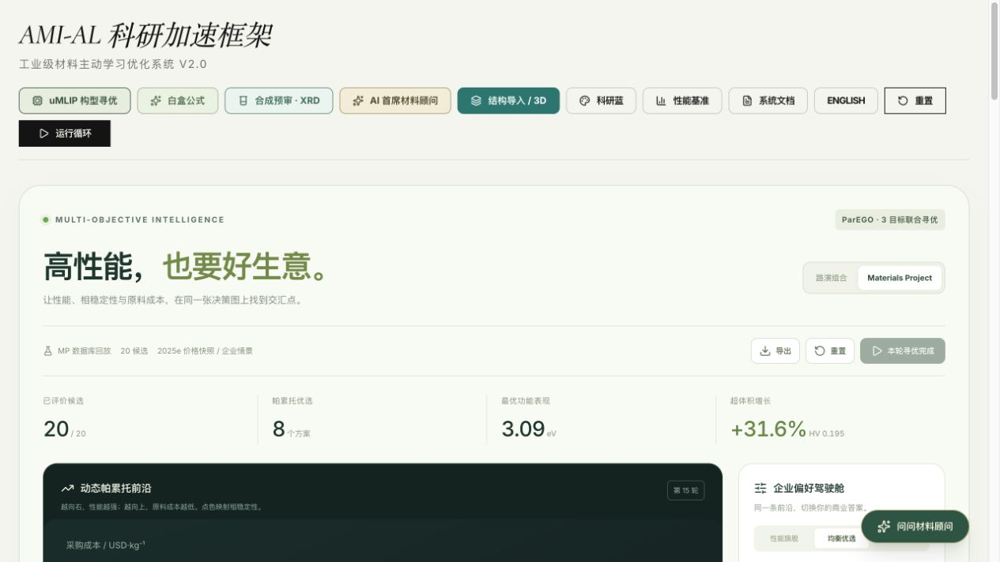
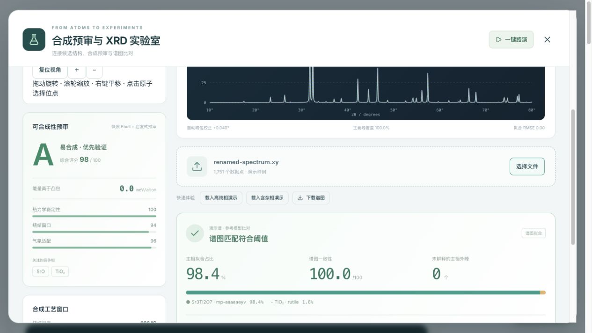

# 五工作流整合验收（2026-10-28）

验收代码提交：`2a0769d7b9c7d89beb20283bbf4b2ce0859de760`。随后同步上游历史及补充本记录，没有改动已验收的应用代码。环境为 macOS arm64、Node.js v22.22.2。

| 检查 | 结果 |
| --- | --- |
| `npm test` | 261 项通过，0 失败、0 跳过；含 11 项新增联合回归 |
| `npm run lint` | TypeScript 类型检查通过 |
| `npm run build` | 生产构建通过，仍有大于 500 kB 的产物体积提示 |
| 公式 Worker 浏览器页 | observed、teacher、隐藏标签隔离、取消和重启全部通过 |
| 七模型 Worker 浏览器页 | 22维输入、1000候选预测；20000候选取消、主线程响应及重启通过 |
| `npm run verify:umlip` | 实际载入本地MACE，完成2轮、4个收敛构型 |

Python XRD 数值回归使用已安装的科学Python；零跳过结果依赖该环境可用，不代表纯Node安装包含Python依赖。uMLIP使用MACE-MPA-0 medium、CPU、float64、2线程；本次输入为五原子SrTiO3示例。权重SHA256、运行ID、固定参考能及验收摘要见[机器可读记录](five-workflows-20261028.json)。模型力收敛不等于DFT精度或相稳定性验证。

## 联合回归范围

`tests/FiveFeatureIntegration.test.ts` 使用明确标记的合成契约夹具和隔离数据库，覆盖：

- SQLite→HTTP→Engine→Pareto的数据来源、零Ehull、辅助目标及记录血统保留，且不改写原单目标采样状态。
- 目标最小化贯穿AL与顾问；七种Hub目标的单位、方向和快照血统，隐藏标签隔离及非带隙公式拟合。
- 数据库结构精确版本与规范化几何SHA256比对；合法格式但错误的摘要也被拒绝。
- 演示谱、导入替代晶胞、跨数据集同ID、旧版本与旧v1反馈不能改变真实记录；先验幂等且不改标签。
- 演示谱下载、改名、重导入后保持证据标记。
- Hub、uMLIP、synthesis路由共存及大请求体解析器；预审读取精确快照，缺失Ehull保持未知。

## 浏览器实查

- 帕累托演示完成30条评价；切换Hub目标后仍保留结果。
- 公式补充数据和文本随目标切换清空；形成能公式按`eV/atom、min`展示并导出。
- 真实离线MP帕累托入口完成20条评价；当前真实三目标明确限定带隙、Ehull和采购价格。
- uMLIP面板正常读取本地配置；XRD实际调用pymatgen，并显示对应快照Ehull及启发式预审来源。
- 演示谱下载、改名、重新导入后，真实候选的“反馈主动学习”仍禁用，并显示原因。

本次浏览器MP记录来自真实本地快照；谱图演示是合成数据。回放超体积、公式回收和工作流耗时均不构成真实材料泛化、定量纯度或发现加速倍率证据。

