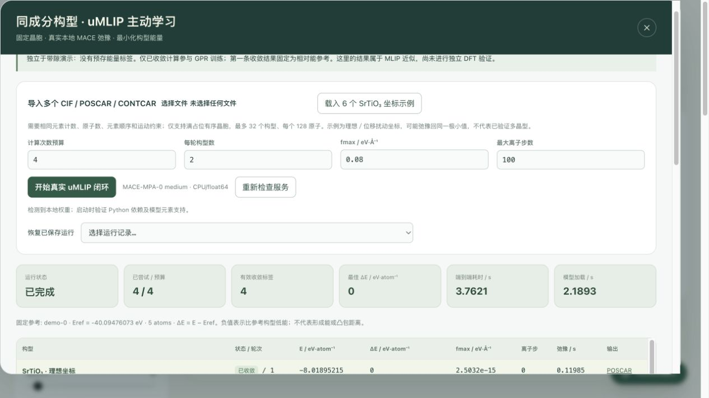

# uMLIP 首版本地验证（2026-10-28）

本记录验证同成分构型的“选择—真实 MACE 弛豫—观测回填—重新拟合”闭环。输入为五原子 SrTiO3 的理想及位移扰动坐标，没有预存能量或 DFT 真值。它们不是已验证多晶型，可能弛豫至同一极小值。

## 自动化检查

- `npm test`：196 项通过，0 失败、0 跳过；其中计算服务单元测试使用明确的测试替身，无需 Python 或 MACE。
- `npm run lint`：TypeScript 类型检查通过。
- `npm run build`：生产构建通过，仍有部分大 bundle 的体积提示。
- `npm run verify:umlip`：另行实际载入本地 MACE 权重，完成两轮、四构型计算；输出保存到新的 UUID 目录。

回归覆盖同成分／满占位／约束校验、周期自镜像碰撞、固定晶胞输出、能量单位、最小化符号与 LCB 批次顺序、固定参考、收敛标签隔离、取消与迟到回调、重启恢复持久化，以及 API 输入和同源访问限制。

## 真实计算记录

- 模型：MACE-MPA-0 medium，CPU / float64，2 线程；固定晶胞、保留原子运动约束。
- Python 3.11.15；ASE 3.26.0；PyTorch 2.8.0；mace-torch 0.3.16；NumPy 1.26.4。
- FIRE，`maxstep=0.15 Å`，`fmax=0.08 eV/Å`，最多 100 步；预算4，初始批次2，后续批次2，seed=42。
- Run ID：`64ef06bb-ab0e-476f-8d6e-5bc7570e22d2`。
- 权重 SHA256：`75428afe3a1d7d8062e19bcaabd5c433623cabf308242ec9fb493e38604fb638`。
- 运行器 SHA256：`ec4df6f85caf2b98326d06589cd84cc4d3ff20a6723554557bd9f75bb70032f6`。
- 端到端实测 **3.7621 s**，其中模型加载 **2.1893 s**。这些数字只对应本机这次五原子示例，不是通用性能保证。
- 第一条收敛观测 `demo-0` 固定为参考，`Eref=-40.094760727656 eV`；后续不替换参考。

| 构型 | 状态 | 离子步 | 弛豫 / s | ΔE / eV·atom⁻¹ |
| --- | --- | --- | --- | --- |
| demo-0 | converged | 0 | 0.1199 | 0 |
| demo-1 | pending | — | — | — |
| demo-2 | pending | — | — | — |
| demo-3 | converged | 5 | 0.2006 | 5.0414178e-05 |
| demo-4 | converged | 17 | 0.7369 | 3.83764564e-05 |
| demo-5 | converged | 12 | 0.4373 | 0.000243567314 |

完整输入坐标、参数、输入哈希、模型元数据和已计算结果见 [机器可读记录](umlip-v1-20261028.json)。未计算候选没有能量标签；相对能按 `E−Eref` 计算。表中微小差异不能解释为发现新相。

## 浏览器与异常路径

- 从页面启动真实计算，观察到离子步、坐标、能量、最大受力及实测耗时更新。
- 最大步数1、fmax=0.005 eV/Å 的测试中，未收敛构型保留最后能量／轨迹，但没有有效相对能标签，也不进入训练。
- 弛豫中取消成功；后续候选未被继续计算，保留已完成观测和部分轨迹。
- 实测 POSCAR 下载、多文件结构导入、保存记录恢复、面板关闭重开。
- 20秒延迟初始化测试中，初始化期间导入的六个构型在页面切换后仍保留。
- 独立真实 worker 检查确认：重复候选请求不会修改既有结果目录；含0.1 Å周期自镜像接触的单原子晶胞被拒绝。

## 适用边界

本验证证明软件流程实际调用了 uMLIP，未进行独立 DFT 能量、力或几何精度评估。MLIP 力收敛不证明 DFT 收敛、相稳定性或材料性能；没有执行 VASP、ABACUS、NEB、MD 或实验。完整轨迹、权重和本机路径配置不随代码提交；可按 [工作流说明](../umlip-active-learning.md) 使用可信本地权重复现。
